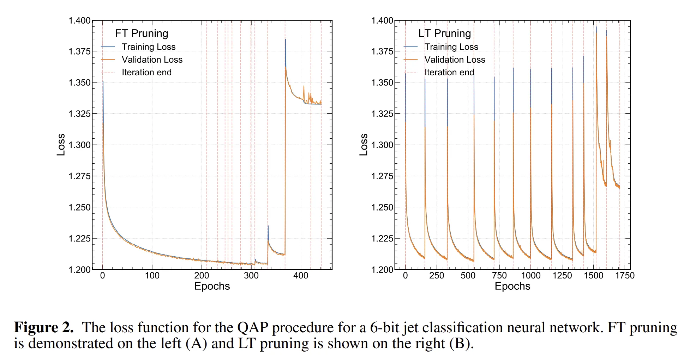

# Ps and Qs

Ps and Qs: Quantization-Aware Pruning for Efficient Low Latency Neural Network Inference

2021

近期的quantization-aware training量化感知训练，在**训练时**考虑量化精度（和常见的post-training quantization不同），作者将这个与剪枝结合，提出量化感知剪枝quantization-aware pruning的一种新方法（下面直接称作QAP），得到的模型比通过贝叶斯优化的计算效率更高，同时研究剪枝和量化的相互作用。

QAP的其他方法，可能也可以在分类任务上取得不错的表现，但是在information content and computational complexity上不同，进而导致稳健性、泛化的不同

## benchmark&baseline

关注于任务：高能物理，分类粒子的辐射模式（对撞机40MHz，需要筛选之后分析），O(us)级别的低延迟场景+FPGA受限资源

The dataset contains 870,000 jets, balanced across all classes
- 472,500 jets for training
- 157,500 jets for validation
- 240,000 jets for testing

baseline model是一个MLP，FP32

```py
class BaselineModel(nn.Module):
    def __init__(self):
        super().__init__()

        # 16 - 64 - 32 - 32 - 5, MLP
        self.layer1 = nn.Sequential(nn.Linear(16, 64), nn.BatchNorm1d(64), nn.ReLU6())
        self.layer2 = nn.Sequential(nn.Linear(64, 32), nn.BatchNorm1d(32), nn.ReLU6())
        self.layer3 = nn.Sequential(nn.Linear(32, 32), nn.BatchNorm1d(32), nn.ReLU6())
        self.output_layer = nn.Sequential(
            nn.Linear(32, 5),
            nn.Softmax(dim=1),  # dim=1表示在特征维度上进行Softmax
        )

    def forward(self, x):
        x = self.layer1(x)
        x = self.layer2(x)
        x = self.layer3(x)
        x = self.output_layer(x)
        return x
```

## QAT

因为计算复杂度（sec4）和量化精度2次方，和剪枝线性，先考虑量化；同时QAT比起PTQ更有优势（对比baseline FP32，PTQ在低于14bit定点数就开始acc drop，QAT可以到6bit）；使用逐层异构量化；使用BREVITAS一个pytorch库

QAT和一般神经网络训练过程的不同之处在于，QAT会在训练时也进行量化，让模型去适应量化的损失

这部分不是本文的创新点，只是作为后续的设定，In the following, we refer to this scheme as scaled-integer quantization

### 如何量化

本文采用的量化方式是

$$Q_{\text{int}}(x) = s \cdot \text{clamp}_{y_{\text{min}}, y_{\text{max}}} \left( \text{round} \left( \frac{x}{s} \right) \right) \qquad \text{(1)}$$

其中，$s$ 是缩放因子；取整函数采用round-to-nearest，即四舍五入；截断函数是

$$\text{clamp}_{y_{\text{min}}, y_{\text{max}}}(y) = \begin{cases} y_{\text{min}} & y < y_{\text{min}}, \\ y & y_{\text{min}} \leq y \leq y_{\text{max}}, \\ y_{\text{max}} & y > y_{\text{max}}, \end{cases} \qquad \text{(2)}$$

量化会对于**权重和激活值**进行，都使用公式(1)进行，相当于转化为INT，而且都对每个元素进行（逐元素操作，这些参数都是标量）

**区别**是公式中的参数，下面约定 $n$ 是位宽number of bits in a word，是训练前确定的超参数

对于**权重**，clamp的上下界是 $\pm (2^{n-1}-1)$；缩放因子 $s$ 由公式3确定，这是个由权重确定的参数

$$s_w = \frac{\max_{\text{tensor}}(|W|)}{2^{n-1} - 1} \qquad \text{(3)}$$

对于**激活值**，由于使用了ReLU6激活函数，所以是非负的，clamp上下界是 $[0, 2^n-1]$；缩放因子 $s$ 由一个**可训练的因子**通过公式4得到

$$s_A = \frac{s_{A,\text{learned}}}{2^{n-1}} \qquad \text{(4)}$$

这个因子 $s_{A,\text{learned}}$ 是每层都有的，初始化为6，in line with the ReLU6 activation function

### 和一般神经网络训练的不同

在前向传播时，量化策略也一同进行，让模型去适应量化的损失

反向传播时，除了一般的权重、偏置、BN层得到更新，每层还有一个参数 $s_{A,\text{learned}}$，梯度如下

$$\frac{\partial L}{\partial s_A} = \frac{\partial L}{\partial Q} \cdot \text{clamp}(\text{round}(\frac{x}{s_A})) + \frac{\partial L}{\partial Q} \cdot s_A \cdot \frac{\partial \text{clamp}(\text{round}(u))}{\partial s_A}$$

其中取值操作 $\text{round}$ 是不可导的，所以反向传播时将其视作恒等变换

## 剪枝

下面界定两种剪枝方法：

- fine-tuning/FT：逐层剪枝，带掩码微调，多次迭代
- LT：逐层剪枝，带掩码微调，下次剪枝的时候根据微调后权重分布计算新mask，但是，先把**剩余权重恢复初始值**weight rewinding，再继续训练

> the lottery ticket (LT) hypothesis, which posits that sparse subnetworks exist at initialization which train faster and perform better than the original counterparts.
> 彩票假设，存在dense网络的一个子网络（相当于带着一个mask），训练更快表现更好

LT的做法相当于分步骤逼近这个理想的子网络

作者提出的QAP，也就是在上面的QAT基础之上，再加入训练时剪枝（FT或LT）。**无论是量化还是剪枝都是训练中进行的，这区别于常见的训练后操作**。具体实现方法是：

- 通过BREVITAS进行上文的QAT，6bit
- 每个iteration迭代剪枝10%，按照**整个网络的**权重L1范数作为重要性排序，被减去的参数直接mask置0；目标的90%稀疏度达到后，每次迭代换用比10%更小的剪枝比例
- 加入L1正则化和早停

在figure2中可以看出，LT因为权重的重置，每个iteration需要更多的epoch，训练成本更高，虽然在极度稀疏网络已经崩溃后的loss比FT更低，但是在可用区间内，两种的loss相近，之后的实验结果也表明FT更具实用性

<figure>
  
</figure>

## 实验

略

## 贡献&创新点

- 将剪枝引入训练中量化QAT，并证明这套QAP方案（6bit整数量化时）相比于原始FP32 dense模型准确率只下降0.375%，$\epsilon_b^{\epsilon_s=0.5}$ 上升约23%，但减少了约24.5倍的运算量；相比于FT剪枝+PTQ，表现相近但运算量低至3倍；相较于单纯QAT，运算量约为1/2.18。这说明训练中剪枝和QAT是相补的
- QAP是非结构化的剪枝策略，但通过bayesian optimization得到的结构化剪枝模型，效果没有明显优于QAP。但QAP的表现在低于10e4 BOPs后是断崖式下降，而BO下降缓和很多
- 详尽实验了有无batch norm、L1正则化、FT/LT剪枝的对QAP表现的影响。其中LT相比FT无增益还额外需要约4倍的训练epoch

创新点：

- 在section 5.3的打乱标签实验里还发现，无L1的模型在一定范围内随剪枝幅度（体现为BOPs降低）提高表现更好，支持剪枝有类似L1正则化的作用的解释
- 利用神经效率 $\eta_N$ 衡量打乱标签训练中模型的表现，说明测试集acc表现相似的模型，神经元的信息组织方式可能差别很大。但高 $\eta_N$ 并不保证更强的稳健性

## 想法

- 非结构化剪枝，需要专用稀疏矩阵计算硬件才能实现推理加速
- 单一精度量化，bit是超参数需自行确定，QAT训练中的参数 $s_{A,\text{learned}}$ 仅确定缩放幅度
- 先进行QAT，再进行迭代FT/LT